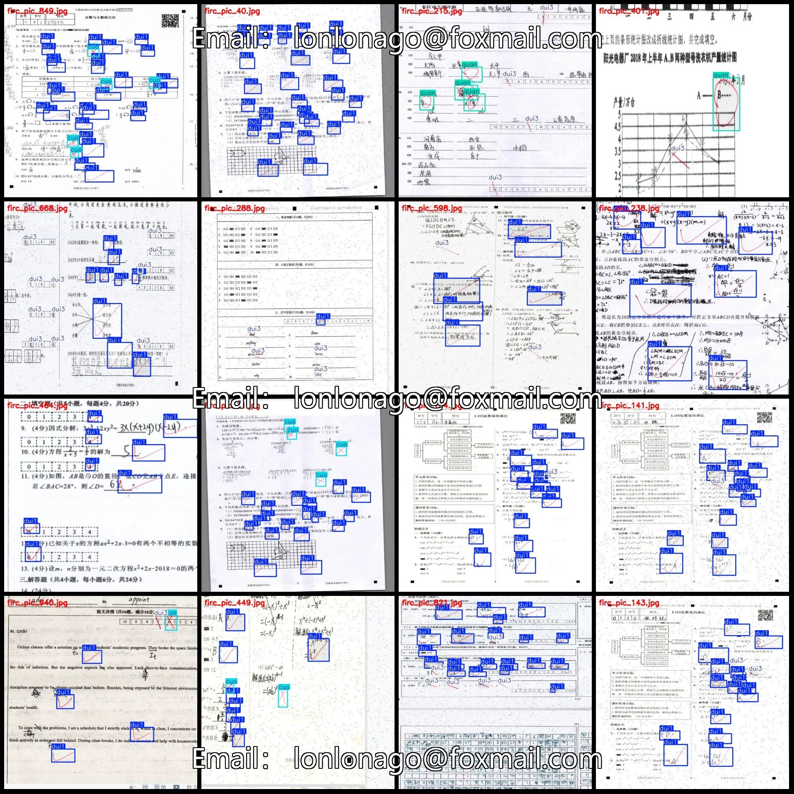
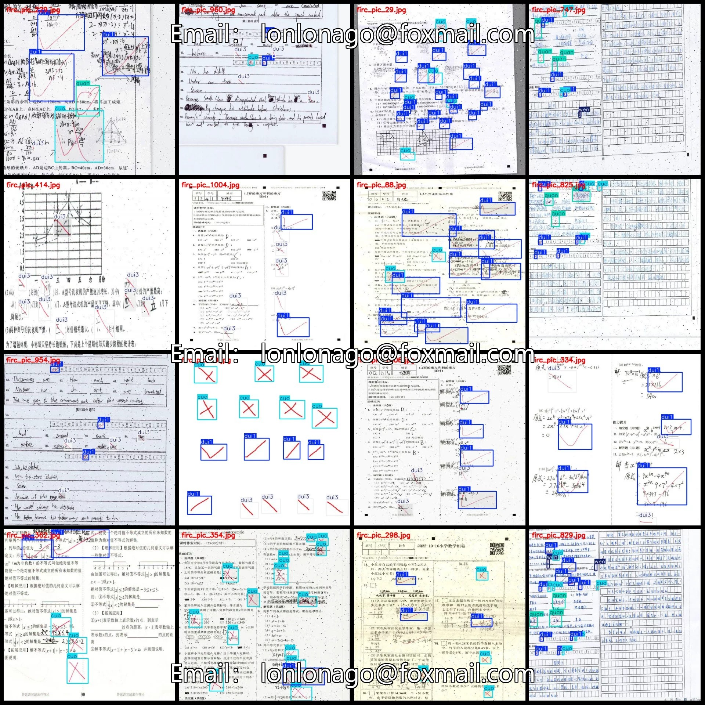
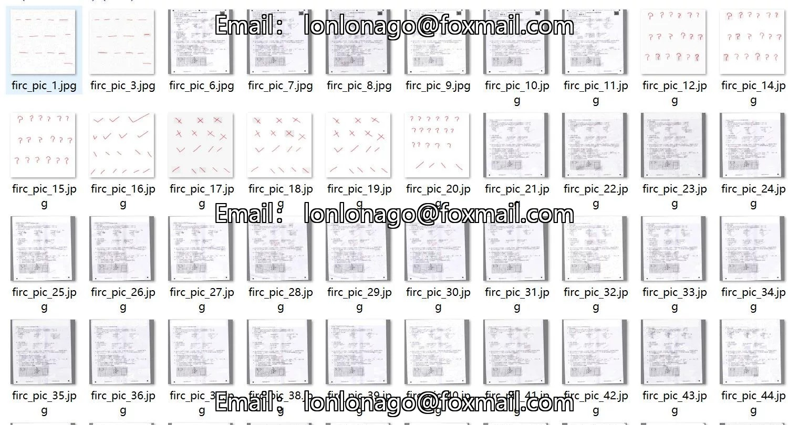
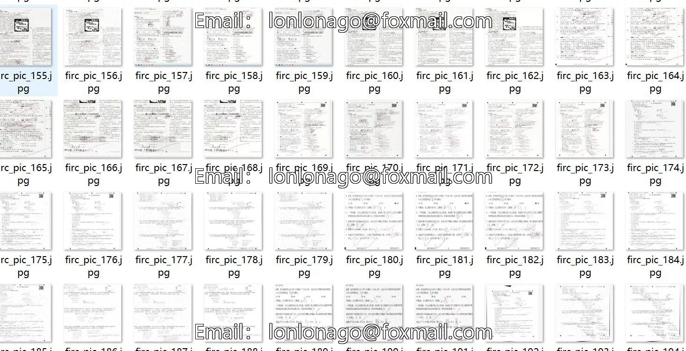

# Dataset for VOC+YOLO format, consisting of 1008 images with corrected, incorrectly marked, and question marks detected by the annotation system.

## Body

The dataset for annotation of wrong-answer circles, question marks, and VOC+YOLO format with 1008 images in 6 categories is enhanced.
Please note: Due to the dataset's replicability, after purchase, please confirm compliance before purchasing.
It is important to note that approximately 300 images are originals, while the remaining are enhanced.
The dataset format includes both Pascal VOC and YOLO (txt files without split paths, only containing jpg images along with their corresponding VOC xml files and YOLO txt files).
Number of images (jpg file count): 1008
Number of annotations (xml file count): 1008
Number of annotations (txt file count): 1008
Number of annotated categories: 6

Annotation categories (note that the order of labels in YOLO format does not correspond to this, but is based on the classes.txt file in the labels folder): ["cuo", "dui1", "dui3", "heng", "quan", "wen"]
Number of bounding boxes and image counts per category:
- cuo (mistake, cross) = 1307 bounding boxes, 453 images
- dui1 (correct, tick) = 8080 bounding boxes, 928 images
- dui3 (correct, tick) = 2294 bounding boxes, 498 images
- heng (horizontal line) = 61 bounding boxes, 8 images
- quan (circle) = 454 bounding boxes, 179 images

wen (question mark) box count = 105, occupied image count = 30
Total box count: 12301
Image resolution: 640x640
Labeling tool used: labelImg
Labeling rules: Draw a rectangle around the category.
Important note: The dataset does not have splits for training, validation, and testing; you need to manually divide it.
Special declaration: This dataset does not guarantee the accuracy of the trained models or weight files.

## Images

## Payment

Here is a pay link on Stripe ( https://buy.stripe.com/3cs8yP7sY87d0vu9AB ). Please contact me lonlonago@foxmail.com after funding $89, and I will send you a complete data files , thank you!

